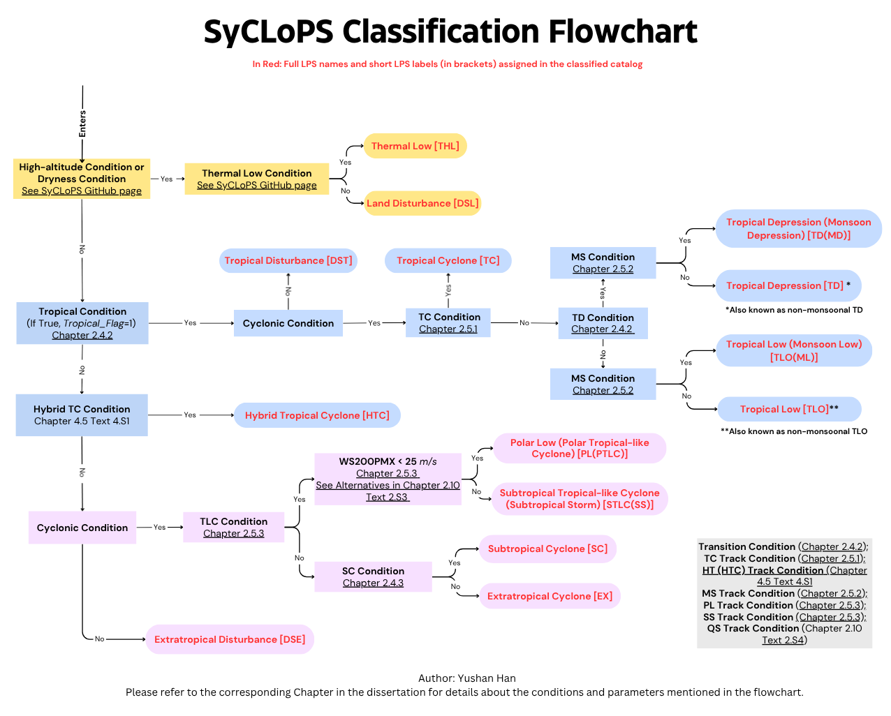

# SyCLoPS

Author:  Yushan Han

Email:   yshhan@ucdavis.edu

Copyright 2025-2026 Yushan Han

The SyCLoPS paper: [https://doi.org/10.1029/2024JD041287]

Paper (preprint) on updates in SyCLoPS v1.1: [https://doi.org/10.22541/essoar.177038847.73410174/v1]

SyCLoPS manual: [https://climate.ucdavis.edu/syclops.php]

New features in v1.2
=====
 
(1) Weak LPS node stitching and unreasonable jumpy nodes issues along tracks are noticebaly improved, especially for 6-hourly tracking. New ERA5 datasets are generated based on this. See the dataset section.  
(2) Introduced the new classification "Hybrid TC." Details will be discussed in our next paper manuscript. Stay tuned for preprint.  
(3) Added columns of LPS translation distance/speed ("distance") and moving direction ("direction").  
(4) Improved data structure: Change "0" and "1" flags to boolean data type. Minimizie data bytes for more a compact file size.  
(5) We removed the high-altitude branch and simplify the dry LPS branch in the classification. Please see an updated classification worflow below:  

  

Some details for (5): We renamed the dry LPS branch to land LPS branch. Within the branch, an LPS node candidate will first need to satisfy eitherthe high-altitude condition or dryness condition, then it will be checked for the thermal-low condition. A thermal low should bear a low-, mid-, or upper level wam core depending on its surface elevation. More details to follow in the upcoming new version of user manual. Stay tuned.  

Introduction
=====

The System for classification of Low-Pressure Systems (SyCLoPS) is an all-in-one framework for objective detection and classification of any type of surface low-pressure systems (LPSs) in any large atmospheric dataset and model outputs in one workflow. The required atmopsheric variables for the framework can be found at `manual/Required_variable.png`. SyCLoPS is capable of labeling the following 14 types of LPS:

| LPS node Label         | LPS Full Name                                      |
|------------------------|----------------------------------------------------|
| THL                    | Thermal Low                                        | 
| DSL / DST / DSE        | Land / Tropical / Extratropical Disturbance        |
| TC / HTC               | Tropical Cyclone / Hybrid TC                       |
| TD / TD(MD)            | Tropical Depression / TD (Monsoon Depression)      |
| TLO / TLO(ML)          | Tropical Low / TLO (Monsoon Low)                   |
| SS(STLC) / PL(PTLC)    | Subtropical Storm (Subtropical Tropical-Like Cyclone) / Polar Low (Polar TLC) |
| SC / EX                | Subtropical Cyclone / Extratropical Cyclone        |

It also labels the four high-impact LPS tracks: TC, MS (Monsoonal System), SS(STLC), and PL(PTLC) tracks. We recently added hybrid TC tracks ("HT" tracks). Tracks are labeled when LPSs are stably labeld as a type of LPS class for a period of time so it can be compared with the corresponding subjective dataset.

Dependencies
=====

The SyCLoPS software is built upon TempestExtremes (TE), the state-of-the-art atmospheric feature detector. The main TE branch can be downloaded at: [https://github.com/ClimateGlobalChange/tempestextremes]  
We recommend using the `quick_make_unix.sh` script (simply run `sh quick_make_unix.sh`) in the TE root directory to install TE.

**Note:** TE now supports proper handling of missing values in model data.

The SyCLoPS software requires the following Python packages: Xarray, Pandas, PyArrow, multiprocess, cftime, and Scipy.

Usage
=====

Simply download the SyCLoPS package to your machine. Then: 

1. Review the codes and comments in `SyCLoPS_main.py`. Change variable names and other specifications according to your needs.

2. Run `SyCLoPS_main.py` and follow the instructions carefully.

Optional steps for tagging precipitation and size blobs of LPSs can be found in the `optional` folder.

Documentation
=====

1. The latest SyCLoPS manual can be found here: https://climate.ucdavis.edu/syclops.php. You can also find the PDF-format manual in the `manual` folder.

2. Details of the various executables that are part of TempestExtremes can be found in the user guide:
https://climate.ucdavis.edu/tempestextremes.php

Datasets
=====

SyCLoPS 1940-2024 ERA5 low-pressure system catalogs and datasets via Zenodo: [https://doi.org/10.5281/zenodo.10906284]  **Updated June 2, 2026. Improved tracks.**  

SyCLoPS 1988-2014 HighResMIP low-pressure system catalogs and datasets via Zenodo: [https://zenodo.org/records/18226201]

SyCLoPS 1988-2014 HighResMIP TC catalogs and datasets can be downloaded via Zenodo: [https://zenodo.org/records/18178615]

Publications
============
If you use the SycLoPS software please cite our publications:

[https://doi.org/10.1029/2024JD041287] Han, Y. and P.A. Ullrich (2025) "The System for Classification of Low-Pressure Systems (SyCLoPS): An all-in-one objective framework for large-scale datasets" J. Geophys. Res. Atm. 130 (1), e2024JD041287, doi: 10.1029/2024JD041287.

[https://dx.doi.org/10.5194/gmd-14-5023-2021] Ullrich, P.A., C.M. Zarzycki, E.E. McClenny, M.C. Pinheiro, A.M. Stansfield and K.A. Reed (2021) "TempestExtremes v2.1: A community framework for feature detection, tracking and analysis in large datasets" Geosci. Model. Dev. 14, pp. 5023–5048, doi: 10.5194/gmd-14-5023-2021.

[http://dx.doi.org/10.5194/gmd-2016-217] Ullrich, P.A. and C.M. Zarzycki (2017) "TempestExtremes v1.0: A framework for scale-insensitive pointwise feature tracking on unstructured grids" Geosci. Model. Dev. 10, pp. 1069-1090, doi: 10.5194/gmd-10-1069-2017. 
